# Web Application Attack Simulation and Layered Security Hardening

## Phase 1: vulnerable application and baseline evidence

The baseline is LegacyDesk, a fictional employee support portal built specifically for eight repeatable demonstrations. It provides working sign-in, ticket creation/search, ticket conversations, profile updates, downloads and report generation. The experiment runs locally in Docker with Nginx forwarding to a Python application and SQLite database. All records and credentials are fictional.

This document contains observed baseline results. Application hardening, WAF deployment, post-hardening results and the complete seven-minute video remain subsequent stages. The neglected-server scenario is simulated through weak application code and configuration; the experiment does not claim to exploit an outdated Nginx binary or a particular CVE.

The screenshots below preserve the original capture. The current portal uses ordinary employee-facing copy without lab banners, credentials, training labels or permanent script-proof markers. The updated recording payloads are in `DEMO_GUIDE.md`.

### Method and evidence

The confirmed baseline collection is [results.json](../output/evidence/baseline-20261014T175425410392Z/results.json). [Raw request/response captures](../output/evidence/baseline-20261014T175425410392Z/http-captures.json) record request bodies, cookies, status codes, response headers and latency. Separate browser demonstrations establish stored script execution, forged-session access, IDOR, SQLi and a real cross-origin form submission. Screenshots below are captures of the running application and recorded measurement page.

### Normal application

Alice signs in and sees her own two seeded support requests. The displayed ticket counts come from the database.

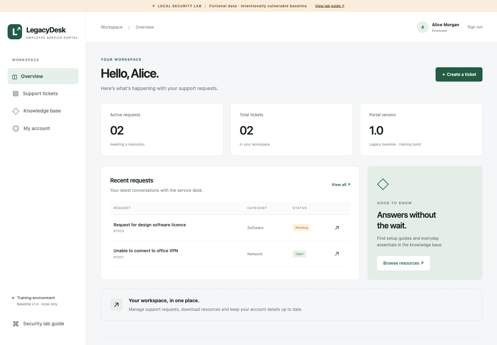

### V01: SQL injection

The login query concatenates supplied credentials into SQL. Submitting username `' OR 1=1 -- ` with password `wrong` selects the first account and grants an administrator identity. The future fix is parameterised queries, supported by WAF SQLi detection.

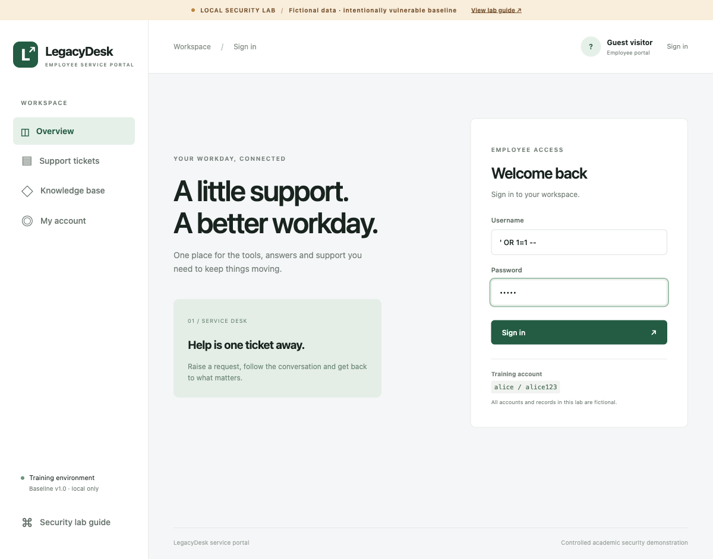

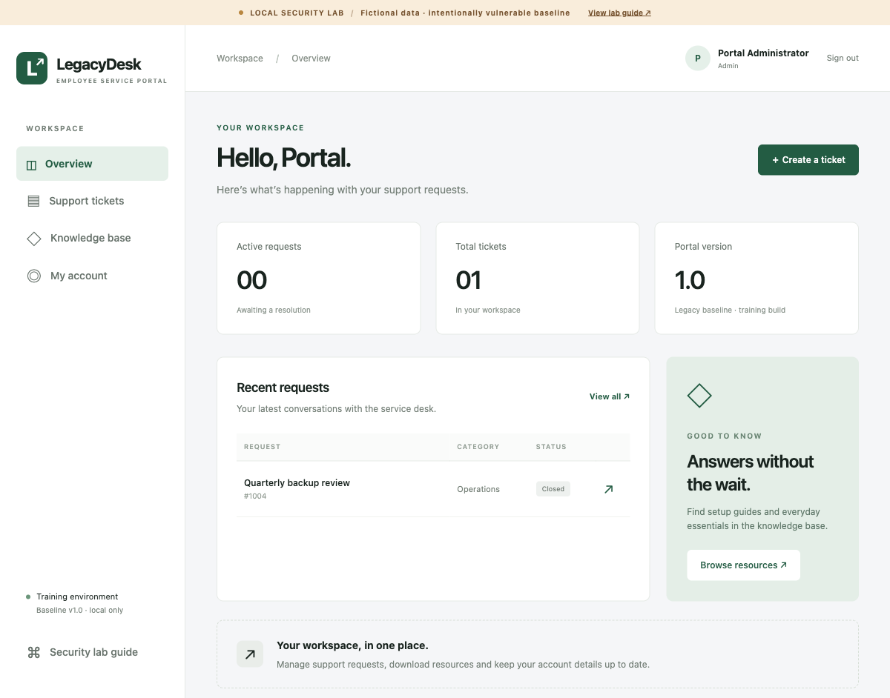

### V02: stored XSS

Ticket comments are stored and rendered without HTML output encoding. A harmless SVG `onload` payload updates the proof marker to `XSS executed` after the ticket is opened. The browser result verifies execution beyond the raw-HTML check performed by the collector. The payload neither sends external traffic nor steals data. Future controls include contextual output encoding, CSP and supporting WAF rules.

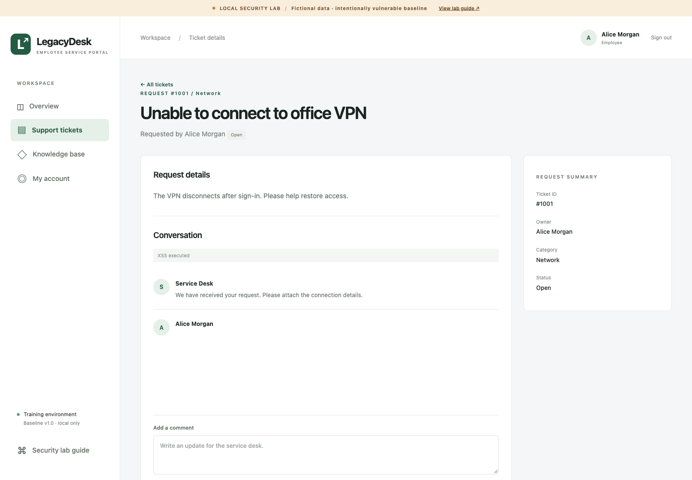

### V03: broken access control / IDOR

Alice changes the ticket identifier to 1002 and reads Bob's fictional confidential payroll ticket. Authentication exists, but the ticket handler does not enforce ownership. Both reading and commenting require server-side permission checks in the hardened stage.

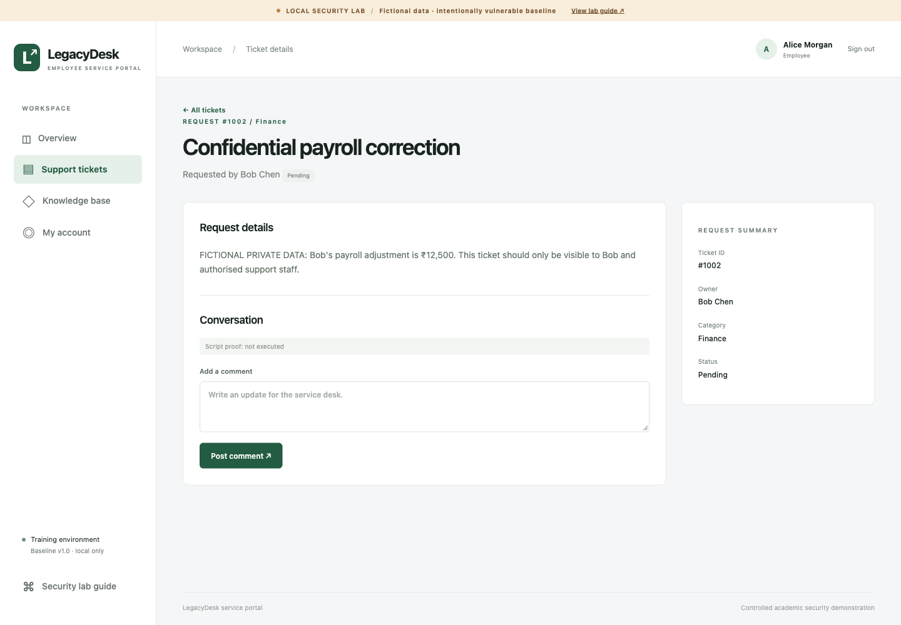

### V04: authentication and session failures

Alice receives HTTP 403 from the administrator page. Changing the unsigned `user_id` cookie to `1` grants administrator access without supplying administrator credentials. Passwords are also weak and stored as plaintext. Future fixes include hashed passwords, stronger credentials, random expiring server-side sessions and proper cookie flags.

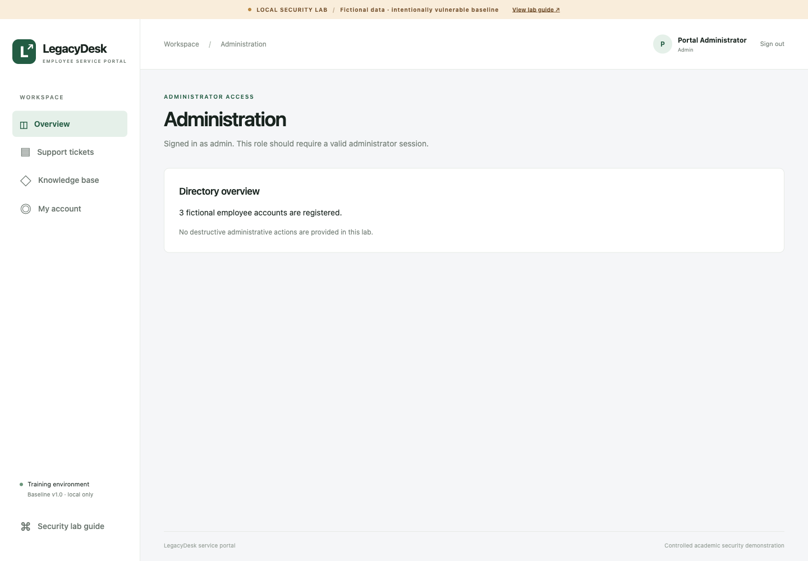

### V05: CSRF

Before the browser form test, Alice's email was restored to `alice@example.test`. A form served from port 8091 then posts to the portal on port 8080 and changes it to `changed-by-csrf@example.test`. The browser sent the session cookie, and the application required neither a token nor an Origin check. These are distinct origins on the same site; the experiment does not claim to bypass cross-site cookie restrictions. All state-changing handlers need protection in the hardened stage.

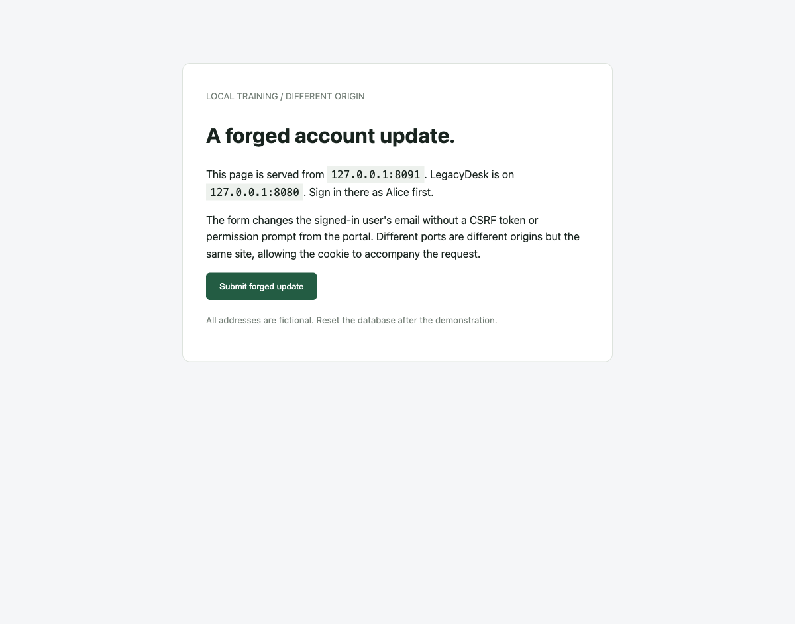

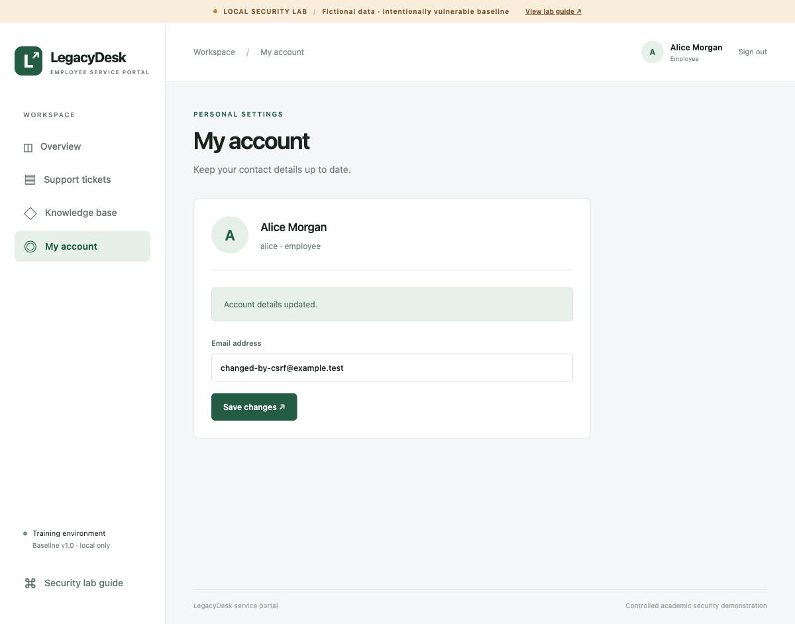

### V06: path traversal

`/download?file=../private/legacy-config.txt` escapes the public downloads directory and returns a private dummy configuration fixture. The lab limits file access to its fixture tree; this containment boundary prevents reading the host filesystem while preserving the demonstrated application flaw. The fix is a download allowlist and canonical public-directory containment.

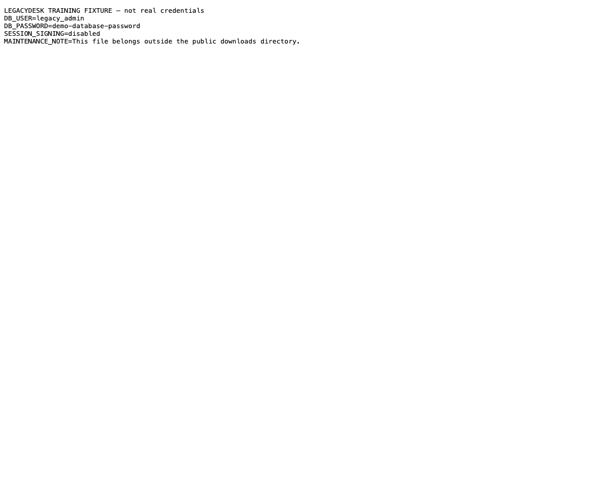

### V07: security misconfiguration

An anonymous request to `/debug` exposes paths, session details and fictional plaintext passwords. Recorded headers also lack `Content-Security-Policy`, `X-Frame-Options` and `X-Content-Type-Options`. Detailed exception output is enabled. Future controls remove public diagnostics, return safe errors and add appropriate headers. HTTPS/HSTS cannot be claimed from this HTTP-only localhost experiment.

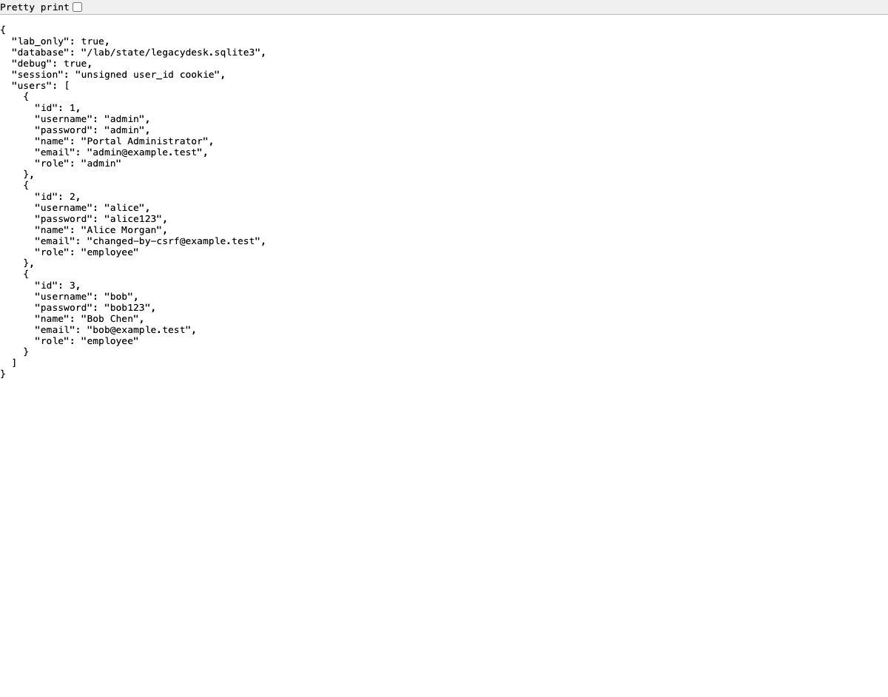

### V08: unrestricted expensive requests

The report handler performs a deliberately bounded 200 ms operation for every request. The confirmed run sent 40 authenticated requests with four concurrent workers: all returned HTTP 200, with no HTTP 429. Measured throughput was **18.92 requests/s**, median latency **211.06 ms**, and p95 **216.76 ms**, over **2.115 seconds**.

This is evidence of missing admission/rate controls under the stated conditions. It does not establish an outage, full machine saturation or protection against volumetric DDoS. [Idle container resource observations](../output/baseline-resources-idle.txt) are labelled separately and must not be presented as measurements taken under load.

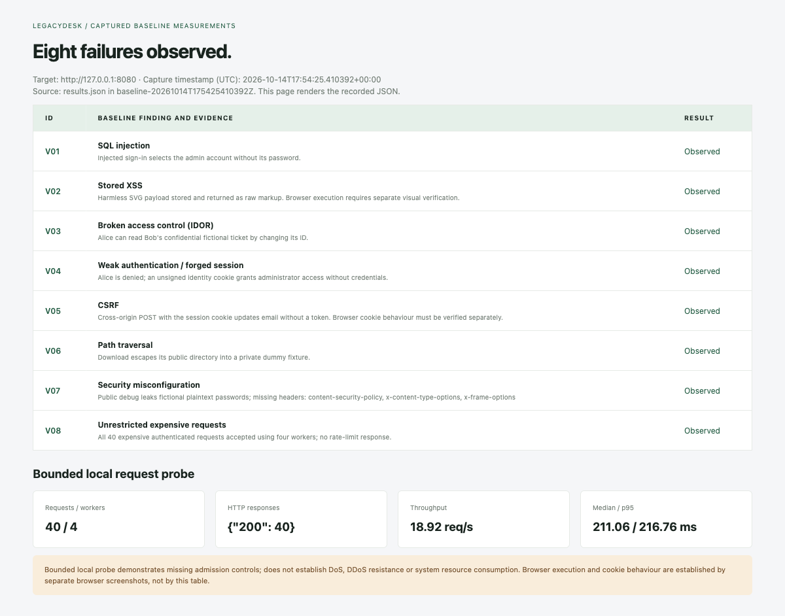

### Next comparison

Preserve the baseline payloads and request conditions, implement root-cause application fixes, add Nginx rate/connection limits and a real CRS-backed WAF, then repeat the same demonstrations. Capture blocked requests, rule IDs/audit logs, HTTP outcomes, latency and resource measurements while confirming legitimate portal use still succeeds. The [demo guide](DEMO_GUIDE.md) contains the proposed seven-minute timing and screenshot checklist; [the finding register](VULNERABILITIES.md) defines each planned control.
