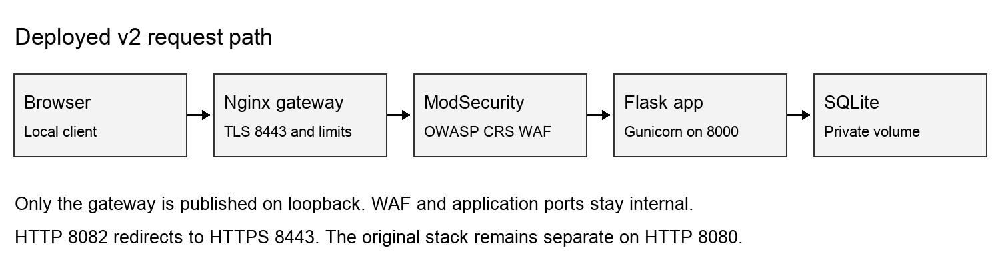
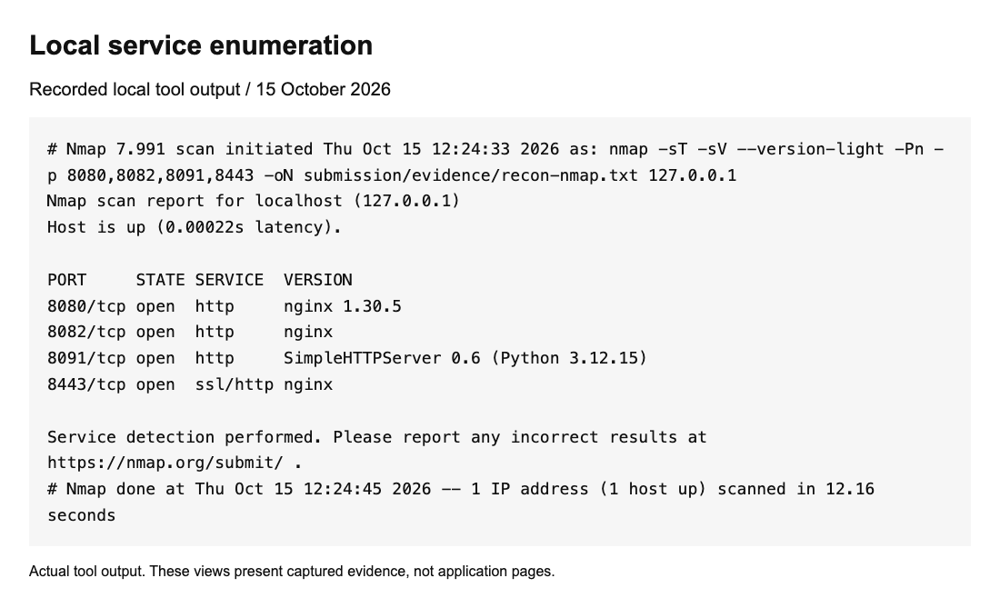
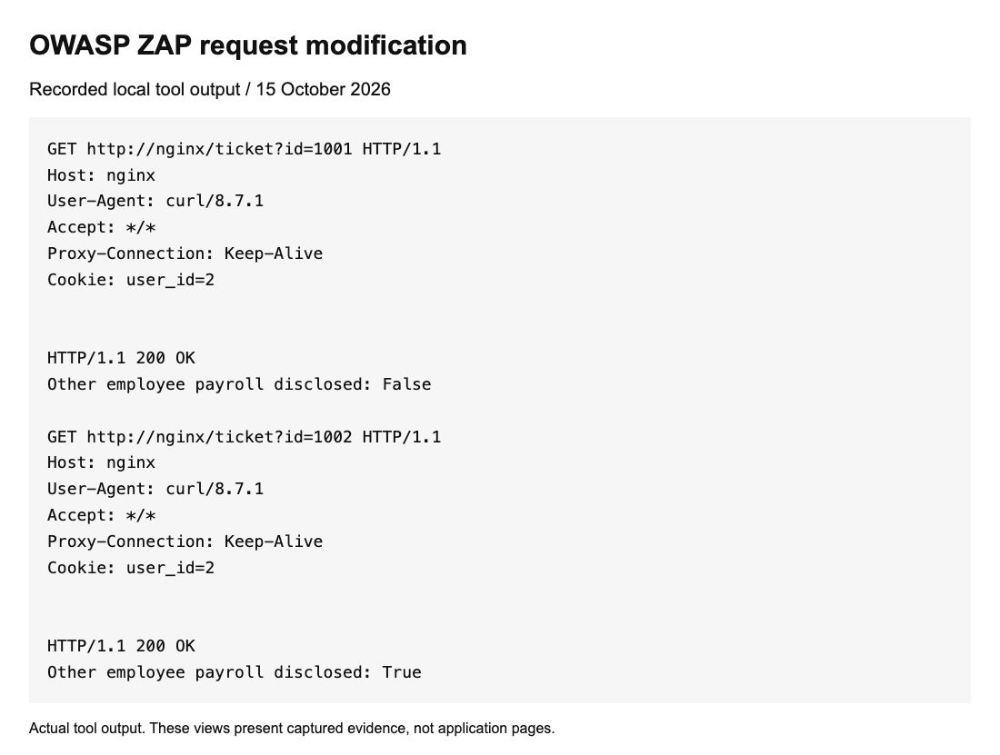
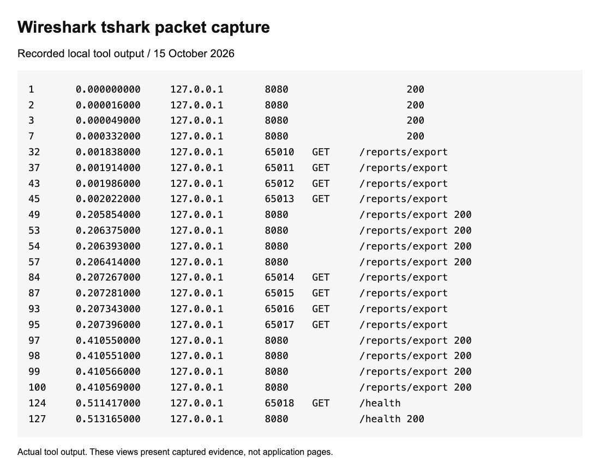
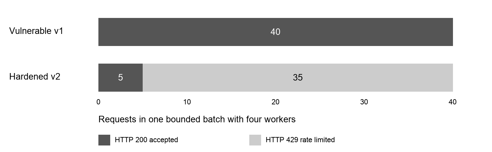
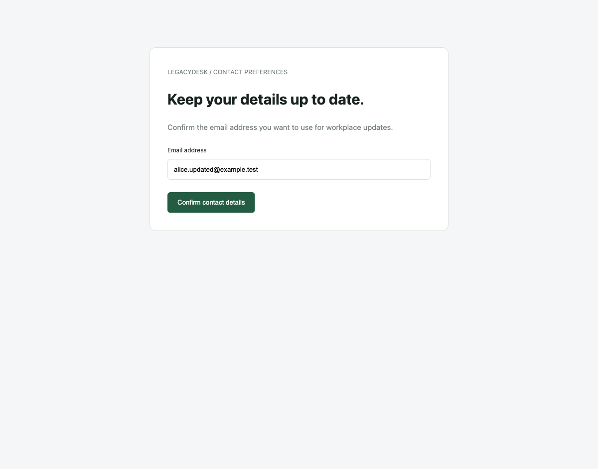
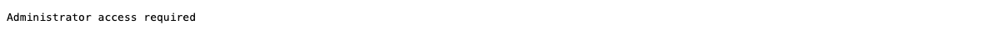

# Web Application Attack Simulation and Layered Security Hardening

WAF Rate Limiting and Defensive Controls

Final technical report  |  Evidence captured 15 October 2026

Project repository: https://github.com/Sidkm18/CFLIA  |  Private

## Purpose and result

We tested eight weaknesses in LegacyDesk, an employee service portal, and implemented a separate hardened version under v2. All eight baseline weaknesses were observed. The final hardened stack passed 19 direct application tests and 17 integration checks. A repeated local load batch changed from 40 accepted requests to 5 accepted requests and 35 rate-limit responses.

This report explains the causes, fixes, reproduction steps and recorded results. It distinguishes real browser captures from labelled HTTP evidence views and includes the supporting raw data. The website itself retains a normal employee-portal interface.

## Submission details

College or institute: ______________________________
Subject and course: ______________________________
Guide or faculty: ______________________________
Team members and roll numbers: ______________________________

## Reading order

The next pages describe scope, architecture, tools and measured results. Each of the eight case studies then has a baseline page and a hardening page. Browser evidence, verification limits, operations and references follow. A separate team pack provides the seven-minute speaking script and rehearsal plan.

---

# Objectives and scope

Design and deploy an intentionally vulnerable application in an isolated local environment.

Demonstrate injection, XSS, authorization, session, CSRF, traversal, configuration and resource-consumption weaknesses.

Identify the root cause of each weakness and implement application and infrastructure controls.

Repeat the attack scenarios and compare status codes, visible behavior, latency and logs.

Preserve ordinary employee workflows while showing how preventive and detective controls work together.

## Environment and boundaries

The measured environment is macOS with Docker Desktop, Python scripts, Nmap, OWASP ZAP, Wireshark tshark and Chromium browser automation. Kali Linux and Burp Suite were in the initial proposed tool list but are not claimed as tools used in these captures. ZAP provided the actual proxy request history.

All target traffic used the self-hosted local stacks or their isolated Docker service names. No third-party target was scanned. The download exposure reaches only a seeded private fixture; the XSS proof changes one local page element. The load workload is capped at 40 requests and four workers.

## Interpretation of the legacy website

V1 already uses Nginx as a reverse proxy. Its weaknesses are in intentionally unsafe application behavior and missing defensive controls. The project does not demonstrate an exploit against an old Nginx CVE, nor does an Nginx version banner establish exploitability. The original 51 tracked files remain byte-for-byte unchanged by SHA-256 comparison.

## OWASP mapping

The case labels use OWASP Top 10 2025 terminology where applicable. Eight tested vulnerabilities do not represent eight different Top 10 categories. Resource consumption is explicitly mapped to OWASP API Security API4 2023. These categories guide analysis; OWASP does not automatically patch an application. [1] [8]

---

# System architecture and defensive layers

Figure 1  Deployed architecture derived from v2 Compose and gateway configuration



| Layer | Implemented behavior |
|---|---|
| Network | Separate Compose projects and database volumes; backend and WAF ports unpublished |
| Gateway | TLS 1.2 or 1.3; HTTP redirect; request and connection limits; body and timeout bounds |
| WAF | ModSecurity 3.0.17 with CRS 4.30.0 in blocking mode at paranoia level 1 |
| Application | Bound SQL; output encoding; ownership checks; session and CSRF controls; fixed download allowlist |
| Resources | Per-user quotas; cached report; anonymous session cap and garbage collection; container and worker limits |
| Detection | Correlated gateway, WAF and application events; no stored live tokens in submitted evidence |

Preventive controls reject known attacks and enforce application policy. Detective controls record rule matches and access denials. The response demonstrated here is automatic rejection with 401, 403, 404 or 429 as appropriate; no SOC alerting or automated incident-response system is claimed.

---

# Test method and evidence provenance

We followed attack, observation, hardening and retest. Baseline capture began at 06:54:46 UTC. The final full-stack retest began at 07:06:30 UTC after the additional session and cache-control changes. Each request series identifies its target and version.

| Evidence | Location in the repository |
|---|---|
| Baseline responses | output/evidence/baseline-20261015T065446247953Z/ |
| Final full-stack checks | v2/output/verification-20261015T070630Z/ |
| Redacted v2 response bodies | submission/evidence/v2-http-responses.json |
| Direct application tests | v2/output/origin-tests.txt |
| Browser and HTTP screenshots | output/playwright/final/ and v2/output/playwright/ |
| Proxy and packet data | submission/evidence/zap-proxy-history.json and local-http.pcapng |
| Dependency audit | submission/evidence/dependency-audit.json |

Screenshots labelled recorded HTTP evidence are browser renders of real captured request and response fields. They are evidence viewers, not screenshots of a portal feature. Real portal screenshots are identified separately. V2 passwords, CSRF tokens and session values are redacted or excluded. The packet capture contains only port 8080 traffic and the intentionally weak seeded v1 values.

Application-only tests use temporary databases and bypass the WAF, showing that root-cause fixes do not depend solely on request signatures. Deployed checks traverse TLS, Nginx, ModSecurity and Flask. Positive tests cover sign-in, authorized ticket access, comments, handbook downloads and logout.

---

# Enumeration and request interception

Figure 2  Nmap output from a bounded scan of four localhost ports



Figure 3  Actual ZAP proxy history showing ticket ID modification with Alice identity



ZAP ran temporarily in a separate container. Only two selected local requests were proxied, with no active scan or spider. Both returned HTTP 200 in v1; the modified request disclosed Bob payroll details. The container was stopped after exporting its request history.

---

# Network capture evidence

Figure 3 A  Wireshark tshark extraction from the recorded loopback capture



The six-second capture recorded 132 packets on loopback with a capture filter for TCP port 8080. The displayed fields are frame number, relative time, source address, source port, HTTP method, request URI and response code. The PCAPNG file is included for inspection in Wireshark.

The capture observes the original HTTP service only. It does not decrypt v2 TLS, quantify distributed traffic, or establish peak resource utilization. The original project uses deliberately weak seeded account values; no generated v2 credential is present in this port-filtered capture.

---

# Measured comparison

Figure 4  Accepted and rejected responses for the same bounded request schedule



| Measure | Vulnerable v1 | Hardened v2 |
|---|---|---|
| Requests and workers | 40 and 4 | 40 and 4 |
| HTTP 200 | 40 | 5 |
| HTTP 429 | 0 | 35 |
| Elapsed seconds | 2.055 | 0.108 |
| Median latency ms | 204.69 | 5.46 |
| p95 latency ms | 207.64 | 41.59 |

V2 rejects excess work early and caches allowed reports. Its measurements include TLS and rejected requests, so lower latency does not mean equivalent successful work ran faster. These are individual local captures, not statistically repeated capacity estimates. Container limits are configured, but the included idle resource snapshot does not establish CPU or memory peaks during a flood.

All eight baseline findings were observed. All 19 direct application tests and 17 final deployed-stack checks passed. WAF evidence includes SQLi rule 942100, XSS rules 941100, 941120 and 941160, path rules 930110 and 930120, and anomaly evaluation rule 949110. Exact results are retained in JSON.

---

# V01 SQL injection before hardening

OWASP mapping: A05 2025 Injection

## Cause and effect

The original login concatenates the supplied username and password into executable SQL. The injected condition changes which row is selected. Search also constructs SQL from the query string. A username payload selects the administrator without knowing the administrator password. Search can also break the normal ownership scope.

## Reproduction

Open the original login page, enter the injected username and a wrong password, and submit. Show the administrator identity. Do not enter a real password.

```text
POST /login
username=' OR 1=1 --
password=wrong
```

Figure V01 A  Recorded baseline HTTP evidence


The recorded response was HTTP 303 with user_id=1. The browser then displayed the administrator identity. A redirect alone would not prove authentication; the returned identity and subsequent page provide that evidence.

---

# V01 SQL injection after hardening

## Implemented fix

V2 looks up the account using a bound SQL parameter, validates username syntax, and verifies a salted password hash separately. Ticket search uses bound parameters and escapes LIKE wildcards. CRS adds SQL injection detection at the gateway. [2]

```text
v2/app/server.py   login and tickets
SELECT * FROM users WHERE username=?
check_password_hash(..., password)
```

Figure V01 B  Recorded response through the deployed hardened gateway


The same injection is rejected with HTTP 403 by the deployed WAF. Direct application tests bypass the WAF and show HTTP 400 for the invalid username, no admin access, and literal search handling.

## Legitimate use

A valid employee can still sign in and search their own tickets.

---

# V02 Stored cross site scripting before hardening

OWASP mapping: A05 2025 Injection

## Cause and effect

The comment body is saved in SQLite and inserted into a later HTML response without output encoding. A browser therefore interprets the stored content as markup. Stored browser code executes when the ticket is viewed. The proof changes only its own element to the words XSS executed; it does not exfiltrate data.

## Reproduction

Sign in as Alice on v1, open ticket 1001, paste the payload into a comment, submit, and show the changed element in the conversation.

```text
<svg onload="this.outerHTML='<p>XSS executed</p>'"></svg>
```

Figure V02 A  Recorded baseline HTTP evidence


The payload was stored and returned as raw markup. A fresh browser capture showed XSS executed inside the conversation. The DOM check found one proof paragraph, confirming execution rather than merely displaying source text.

---

# V02 Stored cross site scripting after hardening

## Implemented fix

V2 HTML-encodes comment bodies and other untrusted text at rendering time. CSP disallows inline script and event handlers. CRS blocks the incoming XSS pattern. Encoding is the root-cause fix; a WAF rule is an additional layer. [3]

```text
v2/app/server.py   ticket
<div class="comment-body">{esc(c["body"])}</div>
v2/infra/gateway.conf   Content-Security-Policy
```

Figure V02 B  Recorded response through the deployed hardened gateway


The full-stack replay receives HTTP 403. A separate direct-origin test stores the same payload and verifies escaped output. The saved v2 browser capture displays the literal payload with zero raw SVG elements and zero executed proof paragraphs.

## Legitimate use

An ordinary comment is accepted and visible on the employee ticket.

---

# V03 Broken object access control before hardening

OWASP mapping: A01 2025 Broken Access Control

## Cause and effect

The original ticket endpoint requires a signed-in identity but does not check whether that identity owns the requested object. Changing an ID is sufficient to select another employee record. Alice can read Bob payroll information by requesting ticket 1002. This is an authorization failure even though the request is authenticated.

## Reproduction

Open Alice ticket 1001. Change only the id parameter to 1002 in the address bar or ZAP request editor. Keep the same Alice identity.

```text
GET /ticket?id=1002
Cookie: user_id=2
```

Figure V03 A  Recorded baseline HTTP evidence


HTTP 200 returned Bob payroll adjustment to Alice. The screenshot shows both Alice in the signed-in header and Bob as the ticket owner. ZAP history separately records changing 1001 to 1002.

---

# V03 Broken object access control after hardening

## Implemented fix

V2 resolves the ticket through ticket_for and checks owner_id against the server-side user ID, with an explicit administrator exception. The same check runs before reading a ticket or adding a comment. [4]

```text
v2/app/server.py   ticket_for
if ticket["owner_id"] != g.user["id"]
   and g.user["role"] != "admin": abort(403)
```

Figure V03 B  Recorded response through the deployed hardened gateway


Alice receives HTTP 403 and the response does not contain Bob payroll text. Direct tests also deny comment writes to Bob ticket, while Bob and the administrator retain authorized access.

## Legitimate use

Alice can still read and comment on ticket 1001.

---

# V04 Forged identity cookie before hardening

OWASP mapping: A07 2025 Authentication Failures

## Cause and effect

The original user_id cookie is accepted as the identity itself. Its integer value is neither unpredictable nor validated against a server-side session. Original passwords are also weak and stored as plaintext. Replacing Alice user_id=2 with user_id=1 grants administrator privileges without authenticating as the administrator.

## Reproduction

Show /admin denied to Alice. In browser cookie tools change user_id from 2 to 1, reload /admin, and show that access is now granted.

```text
GET /admin
Cookie: user_id=1
```

Figure V04 A  Recorded baseline HTTP evidence


Alice received HTTP 403 on /admin. The forged administrator cookie received HTTP 200 and displayed the administrator page. This isolates session forgery from the separate SQL injection weakness.

---

# V04 Forged identity cookie after hardening

## Implemented fix

V2 uses a random 256-bit session token, stores only its SHA-256 hash server-side, rotates it at login, and revokes it at logout. It enforces idle and absolute expiry, caps sessions per user, and hashes unique generated passwords using PBKDF2. The cookie has Secure, HttpOnly and SameSite Strict attributes. [5]

```text
v2/app/server.py   new_session and finish
COOKIE = "__Host-legacydesk_v2"
secrets.token_urlsafe(32)
PASSWORD_METHOD = "pbkdf2:sha256:600000"
```

Figure V04 B  Recorded response through the deployed hardened gateway


A request containing only user_id=1 receives HTTP 401 in v2. A valid Alice session still receives HTTP 403 on /admin. Direct tests verify old-password rejection, rotation, expiration and logout invalidation.

## Legitimate use

Valid employee login works; the administrator role is tested separately.

---

# V05 Cross site request forgery before hardening

OWASP mapping: A01 2025 Broken Access Control

## Cause and effect

The original email update accepts a form POST with a session cookie without validating a CSRF token or the request Origin. A form hosted on a different origin can update Alice contact address using her browser session. The local example uses a second port, so it is cross-origin while remaining on the same site.

## Reproduction

Keep Alice signed in on v1. Open the contact-preferences form at port 8091 and press Confirm contact details. Show the destination account page.

```text
POST /account/email
Origin: http://127.0.0.1:8091
email=alice.updated@example.test
No CSRF token
```

Figure V05 A  Recorded baseline HTTP evidence


The HTTP replay returned 303 and the account contained the replacement email. A real browser also submitted the separate contact-preferences page and arrived at the updated account.

---

# V05 Cross site request forgery after hardening

## Implemented fix

Every v2 state-changing form includes a synchronizer token tied to the server-side session. The server validates the token with a constant-time comparison and requires an exact allowed Origin, including for login and logout. SameSite Strict provides another browser layer. [6]

```text
v2/app/server.py   prepare
Origin must belong to configured ORIGINS
hmac.compare_digest(token, g.session["csrf"])
```

Figure V05 B  Recorded response through the deployed hardened gateway


The cross-origin tokenless HTTP request receives HTTP 403 even when the harness supplies the authenticated cookie. A subsequent account read verifies the email is unchanged. Valid same-origin browser forms continue to work.

## Legitimate use

An authenticated update with the correct token and Origin succeeds.

---

# V06 Path traversal before hardening

OWASP mapping: A01 2025 Broken Access Control

## Cause and effect

The original download endpoint joins an attacker-controlled filename to the downloads directory. Parent components can escape that directory into a private fixture directory. A request for ../private/legacy-config.txt discloses the private configuration fixture. The containing fixtures boundary prevents this exercise from reading arbitrary host files.

## Reproduction

Open the original download URL with the parent-directory filename. Point out the private configuration response instead of the public handbook.

```text
GET /download?file=../private/legacy-config.txt
```

Figure V06 A  Recorded baseline HTTP evidence


HTTP 200 returned the internal configuration, including the fixture DB_PASSWORD value. These are seeded project values, not real infrastructure credentials.

---

# V06 Path traversal after hardening

## Implemented fix

V2 authenticates downloads and maps the exact allowed name employee-handbook.txt to a fixed server-owned file. User input is never combined into an arbitrary path. CRS provides an additional path-access filter. [1]

```text
v2/app/server.py   download
allowed = {"employee-handbook.txt": fixed_path}
if filename not in allowed: abort(404)
```

Figure V06 B  Recorded response through the deployed hardened gateway


The deployed malicious filename receives HTTP 403 from the WAF without configuration data. Direct-origin tests return 404 for traversal, absolute paths and encoded variants. The public handbook still downloads for authorized users.

## Legitimate use

The authenticated employee handbook request receives HTTP 200.

---

# V07 Exposed diagnostics and missing headers before hardening

OWASP mapping: A02 2025 Security Misconfiguration

## Cause and effect

The original /debug endpoint is publicly reachable and serializes the user table, including plaintext passwords. Error details are verbose and browser security headers are absent. An anonymous visitor can retrieve seeded account credentials and implementation details. Missing browser policies leave fewer constraints on framing, content interpretation and injected code.

## Reproduction

Open /debug anonymously and inspect the response headers. Use the captured seeded values only; never put generated v2 credentials on screen.

```text
GET /debug
No authentication
```

Figure V07 A  Recorded baseline HTTP evidence excerpt through the first account


HTTP 200 exposed debug=true, the database location and the seeded password values. The captured response lacked CSP, X-Frame-Options and X-Content-Type-Options.

---

# V07 Exposed diagnostics and missing headers after hardening

## Implemented fix

V2 removes the debug route, returns generic public error pages and keeps diagnostic exceptions in server logs. Nginx and the application set CSP, nosniff, frame restrictions, referrer and permissions policies. HTTPS adds HSTS. Gateway errors also use Cache-Control no-store. [1]

```text
v2/app/server.py   error and finish
v2/infra/gateway.conf   add_header ... always
No /debug route is registered
```

Figure V07 B  Recorded response through the deployed hardened gateway


Anonymous /debug returns HTTP 404 with no password data. Security headers are present on error responses. The Nmap scan shows a version banner on v1, while v2 suppresses the Nginx version; banner removal is a supporting measure, not a patch by itself.

## Legitimate use

Normal portal pages remain available with the same visual design.

---

# V08 Unrestricted expensive requests before hardening

OWASP mapping: API4 2023 Unrestricted Resource Consumption

## Cause and effect

The original export performs work for every authenticated call and has no fine-grained admission control or caching. Its artificial 0.2 second delay makes repeated expensive work observable in a bounded local test. One identity can repeatedly consume report capacity. The experiment measures unrestricted admission; it does not demonstrate an outage or a distributed denial-of-service attack.

## Reproduction

Run the bounded baseline probe against localhost. Keep the request count and worker count visible. Show the status distribution before discussing latency.

```text
GET /reports/export
40 requests total
4 concurrent workers
Authenticated Alice identity
```

Figure V08 A  Recorded baseline HTTP evidence


All 40 requests returned HTTP 200. Elapsed time was 2.055 s, median latency 204.69 ms and p95 207.64 ms. No HTTP 429 was observed.

---

# V08 Unrestricted expensive requests after hardening

## Implemented fix

Nginx limits request rate and connections. The application uses atomic per-user quotas and caches user-scoped report data for 30 seconds. It also bounds request bodies, worker resources and timeouts. Anonymous sign-in sessions are capped at 1,000 and expired or idle entries are collected on creation. [7]

```text
v2/infra/gateway.conf
reports: 2 requests/second, burst 4; 12 connections/IP
v2/app/server.py   report
rate("report:" + str(uid), 6, 60)
```

Figure V08 B  Recorded response through the deployed hardened gateway


The identical 40-request, four-worker schedule produced 5 HTTP 200 responses and 35 HTTP 429 rejections. Elapsed time was 0.108 s, median 5.46 ms and p95 41.59 ms. The application-only concurrent test separately admits exactly 6 of 40 calls.

## Legitimate use

An allowed report still returns Alice ticket count. Fast rejection contributes to the lower latency; the result is not an equal-work throughput benchmark.

---

# Browser evidence for injection and scripting

Figure 5  V1 administrator identity after injected login


Figure 6  V1 stored payload executed inside the ticket conversation


---

# Browser evidence for encoding and authorization

Figure 7  V2 direct-origin payload displayed as encoded text


Figure 8  V1 Alice session reading Bob ticket


---

# Browser evidence for forged requests

Figure 9  Separate-origin contact form before submission



Figure 10  V1 account after browser form submission


---

# Browser evidence for session forgery

Figure 10 A  V1 administrator access denied to Alice



Figure 10 B  V1 administrator access after changing the identity cookie


---

# Browser evidence for file and diagnostic exposure

Figure 10 C  Private configuration fixture returned by v1 traversal


Figure 10 D  Public v1 debug response with seeded accounts


---

# Browser evidence for normal workflows

Figure 11  Legitimate v2 ticket creation


Figure 12  V2 employee workflow at mobile width


---

# Verification limits and maintenance

## What the results establish

The captured payloads succeed in v1 and are denied or rendered inert in v2. Origin tests demonstrate ownership checks, bound queries, encoding, session and CSRF enforcement independently of the WAF. Valid portal workflows remain available. Anonymous session cleanup and the cap now prevent indefinite accumulation when clients discard pre-login cookies.

## What remains outside the measured scope

This is not an exhaustive penetration test or a claim that the application has no vulnerabilities. The bounded load probe does not establish distributed denial-of-service resistance, network saturation capacity, or behavior under many independent clients. WAF tuning, sustained performance tests, production identity services, alert delivery and backup recovery require separate evaluation.

The dependency audit found no known advisories for the eight pinned Python packages at capture time. It does not cover every operating-system package or future advisory. Some container tags remain mutable; keep the captured runtime versions and review updates before reuse. Local certificates are appropriate to this localhost setup and require renewal; a public deployment needs a managed certificate and deployment-specific host/origin configuration.

## Repeat the verification

```text
docker compose -f v2/compose.yaml exec -T app \
  python -m unittest discover -s tests -v
python3 v2/scripts/verify_stack.py
```

Wait at least 60 seconds between integration batches so persisted quotas can reset. The integration script adds a clearly named ordinary proof comment. Remove only proof records created for the recording; never reset a database containing records you want to preserve. The vulnerable original remains available separately for the before sequence.

## Operational follow through

Review dependency and image updates, renew TLS material, protect the private state directory, rotate credentials when sharing the environment, inspect denied requests, and add alert routing before any real service deployment. Keep generated credentials, TLS private keys and live browser session state out of Git and recordings.

---

# References and submitted files

[1] OWASP Top 10 2025
https://top10.owasp.org/

[2] SQL Injection Prevention Cheat Sheet
https://cheatsheetseries.owasp.org/cheatsheets/SQL_Injection_Prevention_Cheat_Sheet.html

[3] Cross Site Scripting Prevention Cheat Sheet
https://cheatsheetseries.owasp.org/cheatsheets/Cross_Site_Scripting_Prevention_Cheat_Sheet.html

[4] Insecure Direct Object Reference Prevention
https://cheatsheetseries.owasp.org/cheatsheets/Insecure_Direct_Object_Reference_Prevention_Cheat_Sheet.html

[5] Session Management Cheat Sheet
https://cheatsheetseries.owasp.org/cheatsheets/Session_Management_Cheat_Sheet.html

[6] Cross Site Request Forgery Prevention
https://cheatsheetseries.owasp.org/cheatsheets/Cross-Site_Request_Forgery_Prevention_Cheat_Sheet.html

[7] Nginx request limiting module
https://nginx.org/en/docs/http/ngx_http_limit_req_module.html

[8] OWASP API4 2023 Resource Consumption
https://owasp.org/API-Security/editions/2023/en/0xa4-unrestricted-resource-consumption/

[9] OWASP Core Rule Set documentation
https://coreruleset.org/docs/

[10] ZAP Docker documentation
https://www.zaproxy.org/docs/docker/

References checked 15 October 2026. Implementation claims and measurements come from the repository and captured local evidence; the references supply the security concepts and control guidance.

## Deliverables

Editable report and PDF: output/documents and output/pdf. Four-person speaking and rehearsal pack: the matching Team Script documents. Screenshot and silent walkthrough pack: output/playwright/final. Raw captures and comparison data: submission/evidence. Hardened source and verification commands: v2.
