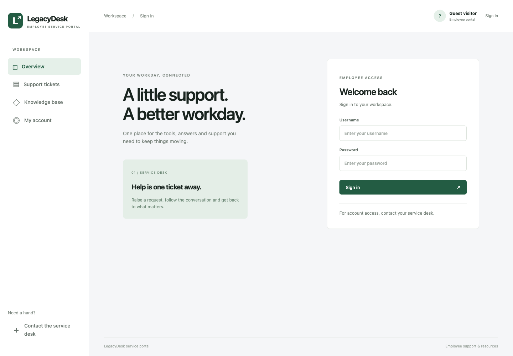
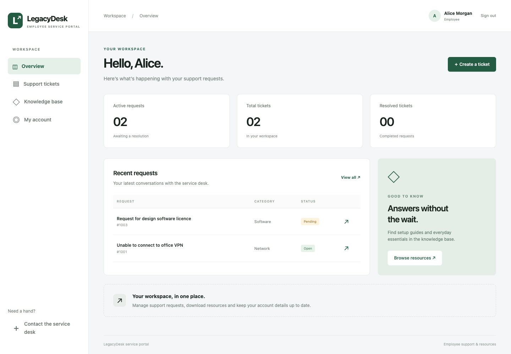
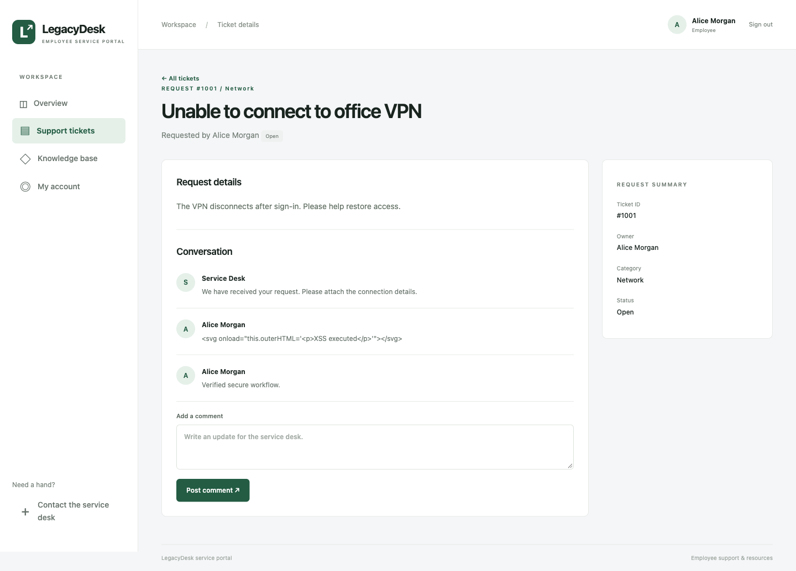
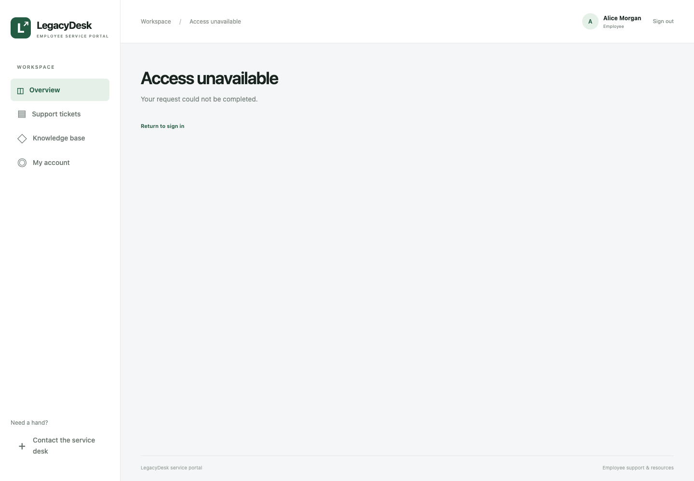
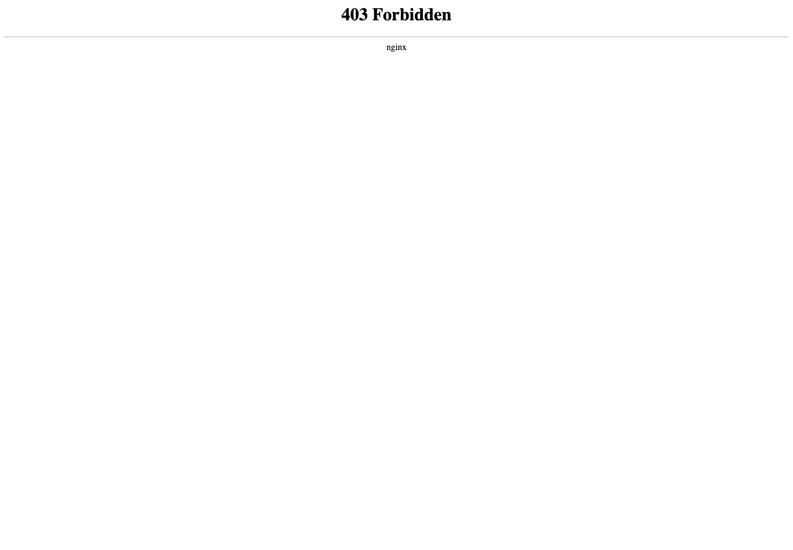
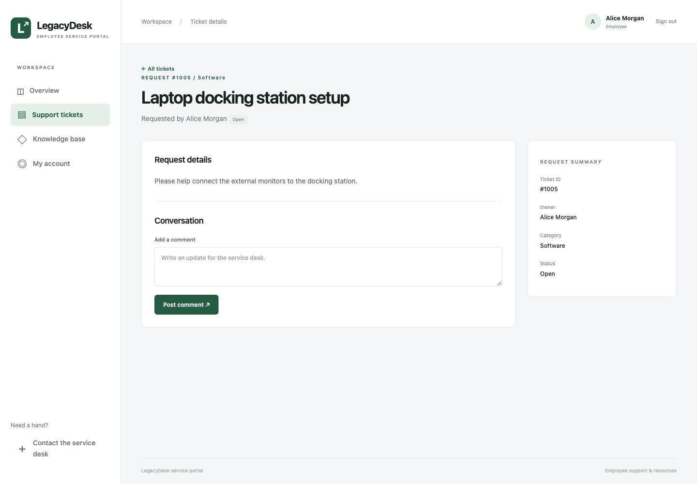
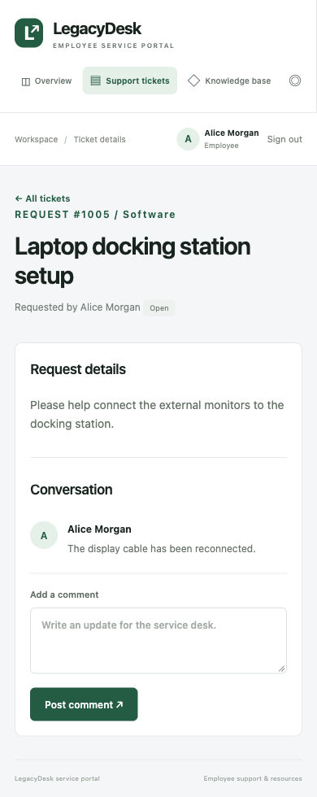
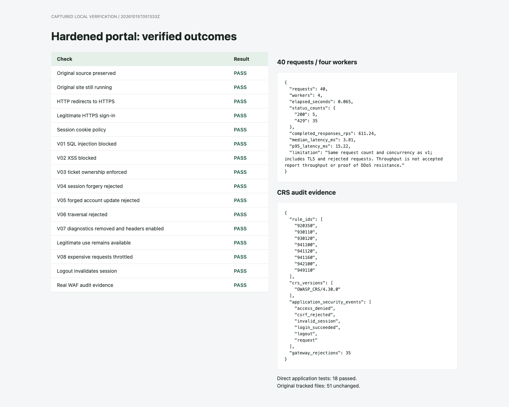

# LegacyDesk: v2 hardening and re-test results

## Scope and preservation

V2 is a separate working application under `v2/`. It uses its own Compose project, internal networks, credentials, sessions, database volume and public ports. The original remains at `http://127.0.0.1:8080`; v2 runs at `https://127.0.0.1:8443`.

All **51 previously tracked files** were compared against a SHA-256 manifest and remained unchanged. The original service passed a read-only health check. No attacks or reset operations were run against the original during v2 verification. Its earlier [baseline report](../../docs/BASELINE_REPORT.md) and [raw baseline results](../../output/evidence/baseline-20261014T175425410392Z/results.json) provide the recorded comparison data.

## Verified controls

| Finding | Recorded vulnerable result | Hardened application | Deployed layered result |
|---|---|---|---|
| V01 SQL injection | Injected login selected administrator | Bound SQL; invalid username rejected; search payload treated literally | CRS SQLi block, HTTP 403; no administrator session |
| V02 stored XSS | Stored SVG executed browser code | Comment stored as text and HTML-encoded on output | CRS blocks incoming payload; direct-origin stored payload remains literal text in the browser |
| V03 IDOR | Alice read Bob's payroll ticket | Ownership/role checks on reads and comment writes | Alice receives 403; Bob/admin positive tests pass |
| V04 authentication/sessions | Forged `user_id=1` granted admin; plaintext weak passwords | Unique strong credentials; salted hashes; random expiring server-side sessions; secure cookie, rotation, logout revocation | Forged cookie receives 401; signed-in Alice receives 403 on `/admin`; valid login succeeds |
| V05 CSRF | Port 8091 form changed Alice's email | Synchroniser token and exact Origin validation on every state change, including login/logout | Forged update receives 403 and email remains unchanged; valid browser forms work |
| V06 traversal | Download returned private dummy configuration | Authenticated fixed-file allowlist; no input-derived filesystem path | WAF 403 or origin 404 for traversal; handbook still downloads |
| V07 misconfiguration | Public debug revealed credentials; headers absent | Debug route removed; generic errors; trusted hosts | 404 without private data; CSP, frame, nosniff, referrer, permission and HSTS headers |
| V08 resource consumption | All 40 slow report requests returned 200 | User-scoped cached reports; atomic per-user quota; bounded work | 5 accepted requests and 35 HTTP 429 rejections in the 40-request/four-worker re-test |

The WAF is the official CRS container pinned to an immutable digest, using **ModSecurity 3.0.17**, **ModSecurity-nginx 1.0.4**, and **OWASP CRS 4.30.0** at paranoia level 1 in blocking mode. This is a rule engine and CRS deployment; no custom substring blacklist is being presented as a WAF.

## Validation evidence

- [19 direct application tests](../output/origin-tests.txt) pass without the gateway/WAF. They cover both malicious requests and legitimate employee/admin use, including concurrent quota enforcement, session expiry, old-password rejection, session rotation and logout reuse.
- [17 deployed-stack checks](../output/verification-20261015T070630Z/summary.md) pass through HTTPS, Nginx, ModSecurity and the application.
- [Captured deployed results](../output/verification-20261015T070630Z/results.json) and [redacted request metadata](../output/verification-20261015T070630Z/requests.json) contain the observed outcomes. Passwords, cookie values and CSRF secrets are excluded.
- [Runtime/image metadata](../output/runtime-versions.txt) records versions used for this run. [Idle resource observations](../output/idle-resources.txt) are separately labelled; they are not presented as measurements under load.
- Gateway and WAF Nginx configuration checks pass; the installed Python dependencies pass `pip check`.

Real WAF audit evidence includes rule IDs **942100** (SQLi), **941100/941120/941160** (XSS), **930110/930120** (file/path access), and **949110** (anomaly-score blocking evaluation). Additional numeric-IP Host policy detection is expected when using the literal localhost address. Audit entries identify the actual loaded CRS version. Application logs independently record denied access, invalid sessions, CSRF rejection and quotas.

## Measured report-request comparison

| Metric | Recorded v1 | Verified v2 |
|---|---:|---:|
| Requests / workers | 40 / 4 | 40 / 4 |
| HTTP 200 | 40 | 5 |
| HTTP 429 | 0 | 35 |
| Elapsed time | 2.115 s | 0.065 s |
| Median response latency | 211.06 ms | 3.81 ms |
| p95 response latency | 216.76 ms | 15.22 ms |

Count, concurrency and endpoint path match the baseline probe. V2 additionally uses HTTPS and valid server-side sessions, and most responses are intentionally rejected. Faster response completion reflects rejected work and report caching; it is not evidence of a 32-fold increase in report-generation capacity. The direct application quota tests admit six requests and reject 34, including simultaneous requests, establishing that the origin has admission control even without Nginx.

These are bounded local observations. They do not demonstrate a volumetric DDoS defence, production capacity, or complete security against all possible vulnerabilities. CPU/memory saturation was not claimed or measured by the request collector.

## Browser evidence

Normal HTTPS sign-in and the dashboard retain the existing portal appearance. Security controls introduce no lab banners or test credentials on the website.

The following payload was deliberately submitted through the hardened application using an internal test client, without publishing a bypass port. The browser displays its literal text; there is no SVG node or generated proof paragraph. This checks application output encoding separately from WAF filtering.

Alice cannot open Bob's ticket while authenticated:

The WAF also blocks an SQLi search request before it reaches the application:

Normal browser ticket creation and comment submission also succeeded through all layers. The mobile view was checked at 390 × 844 with no page-width overflow. Temporary verification records were removed from v2 after capturing these images; the seed records and evidence remain.

## HTTPS and browser compatibility

The local setup generates a CA and signs the server certificate for `localhost` and `127.0.0.1`. Integration checks verify the certificate using that specific CA. The CA is not automatically installed in the system trust store; browser QA uses an isolated context with certificate-error handling for this local address. Public deployment requires a certificate trusted by the target clients and appropriate hostname/origin configuration.

The referrer policy is `same-origin`. This preserves the Origin behaviour needed by same-origin HTML form posts while omitting referrers to other origins. Strict Origin and synchroniser-token checks remain enabled. See [MDN's explanation of referrer-policy effects on Origin](https://developer.mozilla.org/en-US/docs/Web/HTTP/Reference/Headers/Referrer-Policy#effect_on_the_origin_header).

## Handoff

Use [the retest guide](RETEST_GUIDE.md) for the recording sequence and [v2's README](../README.md) for startup, local credentials, logs and shutdown commands. The final narrated seven-minute video and submission-formatted document have not been produced by this implementation step; the runnable secured application, test code and comparison evidence are available here.

## Additional hardening review

Anonymous sign-in sessions are now capped at 1,000 and expired/idle records are collected during session creation, including when browsers discard cookies. The insert and pruning transaction is serialized across workers. Active authenticated sessions are preserved by anonymous pruning. The gateway adds `Cache-Control: no-store` to WAF and rate-limit errors as well as normal application responses. A dependency audit of the eight pinned Python packages on 15 October 2026 found no known advisories; this is a point-in-time dependency check, not a complete vulnerability assessment.

The later 17-check run linked above follows these additions. The earlier load comparison table is retained as its dated historical capture; the final submission report uses the fresh 15 October comparison.
